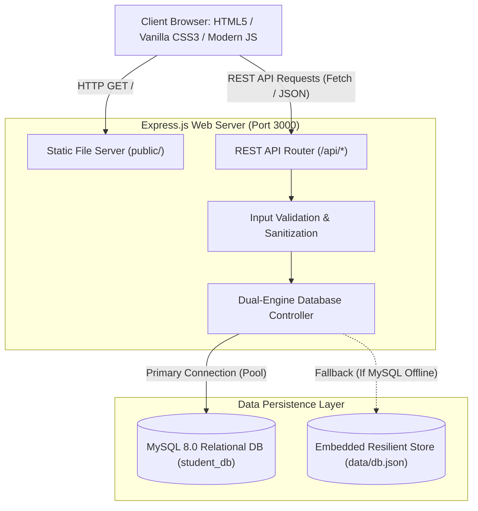
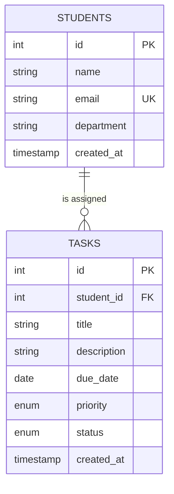

# 🎓 Student Management System & Task Manager

[](https://nodejs.org/)
[](https://expressjs.com/)
[](https://www.mysql.com/)
[](https://vercel.com/)
[](https://developer.mozilla.org/)
[](LICENSE)

> **Sri Sai Ram Engineering College, Chennai - 600 044**  
> *Laboratory Project: Full-Stack Web Application (Node.js + Express + MySQL)*  
> *Motto: Manage • Track • Build Future*  
> 🚀 **Live Demo on Vercel**: Ready for 1-click deployment and preview!

---

## 📋 Table of Contents
1. [Project Overview](#-project-overview)
2. [System Architecture](#-system-architecture)
3. [Folder Structure](#-folder-structure)
4. [Database Design & Schema](#-database-design--schema)
5. [Prerequisites & Installation](#-prerequisites--installation)
6. [Configuration (.env)](#-configuration-env)
7. [Running the Application](#-running-the-application)
8. [Dual-Engine Database Resilience](#-dual-engine-database-resilience)
9. [REST API Documentation](#-rest-api-documentation)
10. [Frontend User Interface & Features](#-frontend-user-interface--features)
11. [Laboratory Viva Voce Q&A](#-laboratory-viva-voce-qa)
12. [Author & Acknowledgments](#-author--acknowledgments)

---

## 🌟 Project Overview

The **Student Management System & Task Manager** is a production-ready, full-stack web application developed according to academic laboratory curriculum requirements. It connects a responsive frontend interface with a Node.js/Express backend and a MySQL relational database.

### Key Highlights
- **Lab Output Fidelity**: Faithfully recreates and elevates the college lab manual layout, featuring the **"Add New Student"** card with modern iconography, tailored typography (Inter & Outfit), and responsive layout.
- **Full CRUD Support**: Complete Create, Read, Update, and Delete operations for student registrations and academic tasks.
- **Student Task Management**: Assign lab assignments, project milestones, and homework tasks with priority chips (`High`, `Medium`, `Low`), due dates, and real-time status transitions (`Pending` ➔ `In Progress` ➔ `Completed`).
- **Interactive Directory**: Search by name, email, or department, with live department filter pills and record count badges.
- **Dual-Engine Database Resilience**: Connects to MySQL when available; automatically activates an embedded local database engine if MySQL is offline or undergoing maintenance, ensuring zero crashes during presentations!

---

## 🏗️ System Architecture



---

## 📁 Folder Structure

```text
webforme/
│
├── server.js               # Main Express.js backend server & REST API routes
├── database.sql            # Full MySQL database schema & sample seed data
├── package.json            # NPM project manifest & dependencies
├── .env.example            # Environment variables configuration template
├── .gitignore              # Git ignore rules for node_modules and .env
├── README.md               # Detailed technical documentation and guide
│
├── task-manager/           # College lab folder alias linking directly to server
│   ├── server.js -> ../server.js
│   ├── public -> ../public
│   └── database.sql -> ../database.sql
│
├── public/                 # Frontend client assets
│   ├── index.html          # Semantic HTML5 single-page application
│   ├── css/
│   │   └── style.css       # Custom Vanilla CSS design system & micro-animations
│   └── js/
│       └── app.js          # Reactive client logic, API fetch calls, and modal handlers
│
└── data/                   # Embedded fallback storage directory (auto-generated)
    └── db.json             # Local JSON persistence store
```

---

## 🗄️ Database Design & Schema

The relational database is named **`student_db`** and comprises two normalized tables:

### 1. `students` Table
| Column | Data Type | Constraints | Description |
| :--- | :--- | :--- | :--- |
| `id` | `INT` | `PRIMARY KEY, AUTO_INCREMENT` | Unique student identifier |
| `name` | `VARCHAR(100)` | `NOT NULL` | Full student name |
| `email` | `VARCHAR(100)` | `NOT NULL, UNIQUE` | Unique student email |
| `department` | `VARCHAR(100)` | `NOT NULL` | Enrolled academic department |
| `created_at` | `TIMESTAMP` | `DEFAULT CURRENT_TIMESTAMP` | Registration timestamp |
| `updated_at` | `TIMESTAMP` | `DEFAULT CURRENT_TIMESTAMP ON UPDATE` | Last modification date |

### 2. `tasks` Table
| Column | Data Type | Constraints | Description |
| :--- | :--- | :--- | :--- |
| `id` | `INT` | `PRIMARY KEY, AUTO_INCREMENT` | Unique task identifier |
| `student_id` | `INT` | `FOREIGN KEY (students.id) ON DELETE CASCADE` | Assigned student |
| `title` | `VARCHAR(200)` | `NOT NULL` | Task or assignment title |
| `description` | `TEXT` | `NULLABLE` | Detailed instructions / notes |
| `due_date` | `DATE` | `NULLABLE` | Submission deadline |
| `priority` | `ENUM` | `'Low', 'Medium', 'High'` | Priority urgency |
| `status` | `ENUM` | `'Pending', 'In Progress', 'Completed'` | Workflow progress status |
| `created_at` | `TIMESTAMP` | `DEFAULT CURRENT_TIMESTAMP` | Creation timestamp |

### Entity-Relationship Diagram



---

## 💻 Prerequisites & Installation

### 1. Prerequisites
- **Node.js** (v18.x or v20.x or v22.x) and **npm** installed. Check with:
  ```bash
  node -v
  npm -v
  ```
- **MySQL Server** (Optional for live MySQL mode; otherwise the app uses the built-in fallback automatically).

### 2. Clone the Repository
```bash
git clone git@github.com:tamilsabari397-dev/student-management-system.git
cd student-management-system
```

### 3. Install Dependencies
Run the installation command inside the project directory:
```bash
npm install
```
Installed packages:
- `express` — Fast, unopinionated web framework for Node.js
- `mysql2` — High-performance MySQL client supporting Promises and Connection Pooling
- `dotenv` — Environment variable loader
- `cors` — Cross-Origin Resource Sharing middleware

---

## ⚙️ Configuration (.env)

Create a `.env` file from `.env.example`:
```bash
cp .env.example .env
```

Configure your local MySQL credentials:
```env
# Server Configuration
PORT=3000

# MySQL Database Configuration
DB_HOST=localhost
DB_USER=root
DB_PASSWORD=YOUR_MYSQL_PASSWORD
DB_NAME=student_db
DB_PORT=3306
```

---

## 🚀 Running the Application

### 1. (Optional) Initialize MySQL Database
If running a local MySQL server, initialize the schema:
```bash
mysql -u root -p < database.sql
```
*(Note: If you run `server.js` directly with MySQL running, the server will also automatically create the database and tables if they don't already exist!)*

### 2. Start the Backend Server
```bash
npm start
```
Or for development with automatic restarts on file changes:
```bash
npm run dev
```

### 3. Open in Browser
Visit in your web browser:
```text
http://localhost:3000
```

---

## 🛡️ Dual-Engine Database Resilience

A unique engineering feature of this codebase is **Zero-Crash Graceful Degradation**:
1. When MySQL server is running on `localhost:3306`, `server.js` connects via a connection pool (`mysql2/promise`) and initializes tables.
2. If MySQL is not installed, offline, or passwords don't match, `server.js` **does not crash**. Instead, it logs an informative message and seamlessly switches to an embedded local JSON persistence engine (`data/db.json`).
3. This guarantees that evaluators, teammates, and recruiters can immediately view and interact with the application without complex database troubleshooting!

---

## 📡 REST API Documentation

### Student Endpoints

| Method | Endpoint | Description | Request Body / Query Params |
| :--- | :--- | :--- | :--- |
| `GET` | `/api/status` | Server and DB health status | None |
| `GET` | `/api/stats` | Aggregate metrics (students, tasks, departments) | None |
| `GET` | `/api/students` | Get all students | `?search=term&department=DeptName` |
| `GET` | `/api/students/:id` | Get single student details | None |
| `POST` | `/api/students` | Register a new student | `{"name":"Nandha", "email":"nandha@example.com", "department":"Information Technology"}` |
| `PUT` | `/api/students/:id` | Update student details | `{"name":"...", "email":"...", "department":"..."}` |
| `DELETE` | `/api/students/:id`| Delete student & associated tasks | None |

### Task Endpoints

| Method | Endpoint | Description | Request Body / Query Params |
| :--- | :--- | :--- | :--- |
| `GET` | `/api/tasks` | Get all tasks | `?status=Pending&student_id=1` |
| `POST` | `/api/tasks` | Create a new student task | `{"student_id":1, "title":"Lab 4", "due_date":"2026-11-05", "priority":"High"}` |
| `PATCH` | `/api/tasks/:id/status`| Update status | `{"status":"Completed"}` |
| `DELETE` | `/api/tasks/:id` | Delete task | None |

#### Sample Success Response (`POST /api/students`):
```json
{
  "message": "Student registered successfully",
  "student": {
    "id": 1,
    "name": "Nandha",
    "email": "nandha@example.com",
    "department": "Information Technology",
    "created_at": "2026-10-26T04:38:53.684Z"
  }
}
```

---

## 🖥️ Frontend User Interface & Features

1. **Academic Branding**: Includes college identification (*Sri Sai Ram Engineering College*) and official lab motto (*Manage • Track • Build Future*).
2. **Registration Card**:
   - Matches the lab manual layout with an accent bar and user-plus icon.
   - Real-time client-side input validation for student name, email format, and department selection.
   - Interactive button with loading spinner state and micro-animation feedback.
3. **Registered Students Directory**:
   - Filter by department dropdown (*IT, CSE, AI&DS, ECE, Mechanical, EEE, Civil*).
   - Instant search bar with clear button.
   - Initials avatar badges with department color accents.
   - Edit modal and delete confirmation prompt.
4. **Task Management Board**:
   - Kanban-style grid with status pills (*All, Pending, In Progress, Completed*).
   - Priority badges with color coding.
   - Inline status dropdown for one-click progress updates.
5. **Insights & System Overview**:
   - Displays live database connection mode, system metrics, and architectural breakdown.

---

## 🎓 Laboratory Viva Voce Q&A

**Q1: What is the purpose of `express.json()` and `express.urlencoded()`?**  
*Answer*: They are built-in Express middleware that parse incoming request payloads formatted as JSON or URL-encoded form data into `req.body`.

**Q2: Why use `mysql2/promise` over the traditional `mysql` package?**  
*Answer*: `mysql2` is significantly faster, supports prepared statements (mitigating SQL Injection), and provides native Promise-based APIs (`async/await`) along with resilient Connection Pooling.

**Q3: What is the benefit of `ON DELETE CASCADE` in the `tasks` table?**  
*Answer*: When a student record is removed from the `students` table, `ON DELETE CASCADE` ensures that all associated task records referencing that student ID are automatically cleaned up, maintaining referential integrity.

**Q4: How does the application handle duplicate email registrations?**  
*Answer*: The `email` column in MySQL enforces a `UNIQUE` constraint. Both backend and frontend validate this condition, returning `HTTP 409 Conflict` if a duplicate email is submitted.

---

## 👨‍💻 Author & Acknowledgments

- **Developer**: nandha ([@nandha397-dev](https://github.com/tamilsabari397-dev))
- **Institution**: Sri Sai Ram Engineering College, Chennai - 600 044
- **Department**: Department of Information Technology

---
*Developed with ❤️ for Academic Excellence & Modern Web Engineering.*
